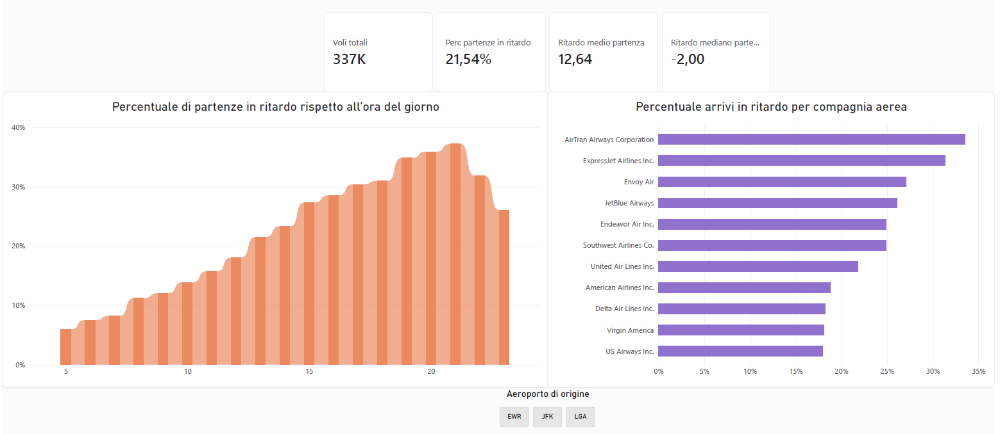
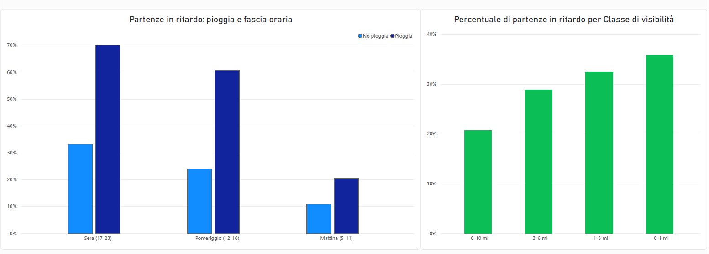
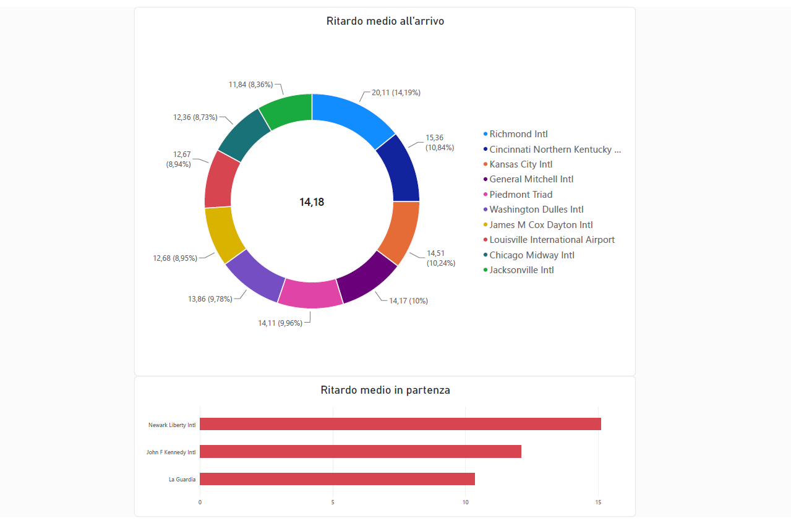

# Flight Performance Analytics

Analisi dei ritardi dei voli in partenza da New York (dataset `nycflights13`, anno 2013, 336.776 voli) con Python, SQL e pandas, più una dashboard in Streamlit e una in Power BI.

**Definizione usata:** un volo è "in ritardo" se parte (o arriva, a seconda dell'analisi) con più di 15 minuti di ritardo. I voli senza dato di ritardo (cancellati) sono esclusi dai calcoli.

## Domande e risultati principali

1. **Percentuale di voli in ritardo:** 23,71% (77.630 su 327.346 voli con arrivo registrato).
2. **Aeroporti:** tra gli scali di partenza, Newark (EWR) ha il ritardo medio più alto (15,11 min), seguito da JFK (12,11) e LaGuardia (10,35). Tra le destinazioni con almeno 1.000 voli, Richmond (RIC) ha il ritardo medio più alto (20,11 min) ed è l'unica delle prime dieci con mediana positiva (+1 min): per le altre la media è spinta da una minoranza di voli molto in ritardo.
3. **Compagnie:** tra quelle con almeno 1.000 voli, American, Delta e US Airways hanno i ritardi medi più bassi; ExpressJet ha il 31% di voli in ritardo. Il confronto non è a parità di rotte e distanze.
4. **Fasce orarie:** i ritardi crescono nell'arco della giornata, dal 6% di partenze in ritardo alle 5 al 37% alle 21. Il volo tipico (mediana) resta quasi puntuale, ma una minoranza di voli molto in ritardo alza la media. L'effetto a catena è un'ipotesi coerente con i dati, non dimostrata qui.
5. **Meteo:** con pioggia il 39% delle partenze è in ritardo contro il 20% senza; l'associazione resta in tutte le fasce orarie (mattina, pomeriggio, sera). Visibilità ridotta e vento forte sono associati a più ritardi. Sono associazioni, non prove di causalità.

## Dashboard Power BI

Le stesse cinque domande sono esplorabili in una dashboard interattiva (`reports/powerbi/flight_performance.pbix`, anteprima in PDF: `reports/powerbi/flight_performance_dashboard.pdf`).





**Modello dati.** Schema a stella: la tabella dei voli (con il meteo già agganciato) è collegata alle dimensioni compagnie, aeroporti e calendario. Gli aeroporti hanno due relazioni, una attiva per la partenza e una inattiva per la destinazione, attivata con `USERELATIONSHIP` nelle misure DAX.

**Misure DAX** (percentuale di partenze e arrivi in ritardo, ritardo medio e mediano, medie per destinazione con minimo di 1.000 voli), **validate contro i risultati delle query SQL e dell'analisi in pandas**: stessi valori su percentuale di ritardi (23,71%), ritardo medio per aeroporto, percentuali per ora e per compagnia.

Le formule DAX sono leggibili in `reports/powerbi/misure_dax.md`.

**Per riaprire la dashboard:**
1. `python src/export_powerbi.py --out <cartella>` genera i tre CSV.
2. In Power BI Desktop imposta *Impostazioni locali per l'importazione* su Inglese (Stati Uniti) e aggiorna il percorso delle origini dati (*Trasforma dati → Impostazioni origine dati*).

## Limiti
- Dati di un solo anno e di soli tre aeroporti di partenza.
- Meteo e ora del giorno sono intrecciati; non sono controllati altri fattori (stagione, traffico, intensità della pioggia).
- Il file `.pbix` contiene i percorsi dei CSV del computer su cui è stato creato: chi lo apre deve aggiornare le origini dati.

## Struttura del progetto
```
data/             database SQLite (generato)
sql/              query usate per l'analisi e per l'esportazione verso Power BI
notebooks/        analisi in pandas e grafici
reports/figures/  grafici esportati
reports/powerbi/  dashboard Power BI (.pbix), PDF e screenshot
src/              caricamento dati, funzioni di analisi, esportazione CSV per Power BI
app/              dashboard Streamlit
```

## Come eseguirlo
```bash
pip install -r requirements.txt
python src/load_data.py
streamlit run app/dashboard.py
```
Il notebook si trova in `notebooks/01_analisi.ipynb`.

Per eseguire una query SQL sul database:
```bash
python -c "import sqlite3; c = sqlite3.connect('data/flights.db'); print(c.execute(open('sql/01_percentuale_ritardi.sql').read()).fetchall())"
```
(sostituisci il nome del file con una delle query in `sql/`; la `06_export_powerbi.sql` è usata da `src/export_powerbi.py`).

## Ambiente

Sviluppato e testato con Python 3.12 su WSL2 (Ubuntu 24.04), in un ambiente virtuale condiviso con altri progetti. Non è stato verificato su un ambiente pulito: se manca una dipendenza, aggiungila a `requirements.txt`.